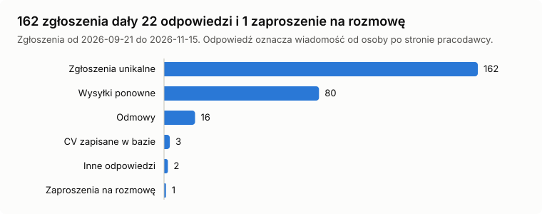

# job-search-agent

The `job-search-agent` repository holds the tools and the method of a job search run with an AI agent. The agent collects offers, builds a CV for each offer, writes a message for one offer at a time and records every send in a ledger. The repository also holds the statistics of one job search, from 2026-09-21 to 2026-11-15.

[Wersja polska](README.md)

Legend: MUST is a requirement. MUST NOT is a prohibition. MAY is a permission. "Or" means at least one of the items. "Either ... or" means exactly one of the items.

## Glossary

| Term | Definition |
|---|---|
| candidate | The person who looks for work and approves the sending rules. |
| agent | A program with a language model that performs the steps of the method: either Claude Code or Codex. |
| profile | A JSON file with the candidate's data for the tools, modelled on `examples/profile.example.json`. |
| ledger | A JSON or JSONL file that records every send attempt with its date and state. |
| route | A pair: one employer and one position. A ledger stores a route as one key. |
| unique application | The first confirmed send of a CV to one route. |
| resend | Every later confirmed send of a CV to a route that already has a unique application. |
| response | One message from a person on the employer's side, recorded in the outcomes file. |

Abbreviations: CBOP (Centralna Baza Ofert Pracy) is the job board of the Polish public employment offices. ATS (Applicant Tracking System) is an employer's recruitment system. CAPTCHA is a test that tells a person from a program. RODO is the Polish name of the EU General Data Protection Regulation 2016/679 (GDPR). SMTP is the mail sending protocol.

## Goal

The method cuts the work spent on applications and keeps one application per offer. The agent performs the repeatable steps. The candidate sets the rules, approves the sending and solves every CAPTCHA.

## Method

The agent performs every step in this order:

1. Collecting offers: `tools/fetch_it_offers.py` fetches IT offers from justjoin.it and No Fluff Jobs. `tools/cbop_scan.py` fetches offers from CBOP.
2. Filter: the script drops an offer outside the candidate's city without remote work. The script also drops an offer whose pay is below the minimum in the profile.
3. Ledger filter: the script skips an offer that a ledger already holds.
4. Order: the script puts AI offers first, then the newest offers.
5. CV for the offer: `tools/build_batch.py` builds the CV from a baseline. The CV gets a headline, a profile and a GDPR consent clause that names the data controller.
6. Message for the offer: the agent writes a message for one offer. `tools/make_plan.py` rejects a plan without a message, without the profile links or without a link to one repository.
7. Sending: the agent either sends an e-mail or fills in a form in the candidate's browser. The e-mail sending panel stays in the private repository.
8. Ledger: `tools/record.py` appends an entry with the date, the state, the evidence seen on the screen and the SHA-256 of the CV file.
9. Mail: the agent puts every thread under one label: reply needed, refusal, CV filed, automatic acknowledgement or bounce. The tool for step 9 stays in the private repository; see "To be moved".
10. Statistics: `tools/stats.py` counts applications from the ledgers and responses from the outcomes file. The script draws an SVG chart.

## Rules

- The agent MUST NOT send a message that reads like a mass mailing. Every message concerns one position.
- Every CV MUST end with a GDPR consent clause that names the data controller and its seat. When the offer gives its own clause, the agent uses that clause word for word.
- CAPTCHA stays with a human. When a form shows a CAPTCHA, the agent records the state `filled-awaiting-owner` and leaves the click to the candidate.
- The agent MUST NOT create accounts on recruitment portals. A route that needs an account stays with the candidate.
- The agent takes facts about the candidate only from the candidate's fact file. The agent MUST NOT add experience or years of work.
- The ledger keeps every attempt, failed attempts included. The agent checks the ledger before every send to avoid a duplicate.
- Personal data stays out of Git: the profile, the ledgers, the CVs and the correspondence live in a private directory.

## Statistics



The chart title and labels are in Polish. The numbers describe the state on 2026-11-15 at 14:35. The file [docs/stats.json](docs/stats.json) holds every number in this section.

| Measure | Count |
|---|---|
| Unique applications | 162 |
| Resends | 80 |
| Messages in an existing mail thread | 17 |
| Routes without a confirmed send | 13 |
| Employer responses | 22 |
| Refusals | 16 |
| Notices that the CV was filed | 3 |
| Other responses | 2 |
| Interview invitations | 1 |

| Month | Unique applications | Resends | Responses |
|---|---|---|---|
| 2026-09 | 2 | 0 | 0 |
| 2026-10 | 83 | 0 | 9 |
| 2026-11 | 77 | 80 | 13 |

| Sending channel | Unique applications |
|---|---|
| e-mail over SMTP | 102 |
| pracuj.pl form | 31 |
| other form: either an ATS or the employer's site | 18 |
| justjoin.it form | 9 |
| No Fluff Jobs form | 2 |

| Offer type | Unique applications |
|---|---|
| job ad on a portal or on the employer's site | 96 |
| unsolicited application, no job ad | 58 |
| offer from CBOP | 8 |

The search in numbers: in September 2026 the agent sent 2 applications by e-mail. In October 2026 the agent sent 83 applications, 80 of them on 2026-10-02. In November 2026 the agent made 80 resends. The agent made 63 resends on 2026-11-03 with the GDPR clause that the October CVs lacked. The agent made 17 resends on 2026-11-11 with a CV that carried a new profile. From 2026-11-09 the agent also applied to CBOP offers. From 2026-11-11 the agent picked AI offers first.

Conclusion: 162 unique applications led to 1 interview invitation. Refusals make up 16 of the 22 responses.

## Running

Requirements: Python 3 with its standard library. `tools/build_cv.py` also needs the `python-docx` and `pymupdf` packages and LibreOffice (`soffice`).

Check the tools without private data:

```sh
python3 -I tools/stats.py --demo
python3 -I tools/fetch_it_offers.py --demo
python3 -I tools/cbop_scan.py --demo
python3 -I tools/make_plan.py
python3 -I tools/record.py --demo
python3 -I tools/correct_cv.py --selftest
python3 -I tools/build_batch.py --demo
python3 -I tools/build_cv.py --demo
```

Result: every command prints `ok`, `selftest ok` or `demo OK`.

Work on your own data. Perform every step in this order:

1. Create the `private/` directory in the repository directory. `.gitignore` excludes `private/`.
2. Copy `examples/profile.example.json` to `private/profile.json` and enter your own data.
3. Save a baseline CV in Markdown in `private/baselines/`, modelled on the demo in `tools/build_batch.py`.
4. Fetch offers with the commands of code block A.
5. Choose offers and save the application plan with the command of code block B.
6. Build the CVs with the command of code block C.
7. After every send, record a ledger entry with the command of code block D.
8. Count the statistics with the command of code block E.

```sh
# A: offers
python3 -I tools/fetch_it_offers.py --profile private/profile.json --seen private/portal-submissions.jsonl > private/shortlist.jsonl
python3 -I tools/cbop_scan.py --profile private/profile.json --out private/cbop-candidates.json
# B: plan (specs, offer details and one message per offer are written by the agent)
python3 -I tools/make_plan.py private/profile.json private/specs.json private/details.json private/messages.json > private/plan.json
# C: CVs
python3 -I tools/build_batch.py --profile private/profile.json --plan private/plan.json --baselines private/baselines --out private/cv
# D: ledger entry
python3 -I tools/record.py --plan private/plan.json --cv-dir private/cv --ledger private/portal-submissions.jsonl \
  --profile private/profile.json it-ai-engineer-acme "Done! Your application has been sent"
# E: statistics (--submissions and --queue read the ledger and the queue of the e-mail panel, when you have one)
python3 -I tools/stats.py --portal private/portal-submissions.jsonl --outcomes private/outcomes.jsonl --out private/stats
```

The outcomes file holds one response per line: date, event type, private reference and source. The event type takes one of 4 values: `refusal`, `cv_filed`, `other_reply`, `interview_invitation`. `examples/outcomes.example.jsonl` shows the format.

## To be moved

The repository holds 8 tools of the method. The list gives the 5 tools that stayed in the private repository, with the reason:

- the e-mail sending panel with its ledger and message copies: the code holds the candidate's mail configuration;
- sorting mail into labels: the code holds the list of employer domains and the candidate's address;
- fetching and filtering pracuj.pl offers: the code holds private paths and the candidate's rules;
- building application rows from CBOP: the code holds offer data and message text;
- checking that offers are still open and finding the data controller in the Polish court register (KRS): the code holds the candidate's routes.

Every tool on the list needs its data moved to the profile and a `demo()` self-check.

## Limits

- The repository sends no messages. Either the private panel or the candidate sends them.
- The statistics describe one job search. They do not describe the job market.
- The application ledgers do not record responses. The candidate records responses in the outcomes file by hand.
- The response count leaves out automatic refusals from portals. The statistics of 2026-11-15 do not count them.
- `fetch_it_offers.py` converts gross to net pay with a flat factor of 0.72. The result is an approximation for the filter.
- The tools work with the portal APIs as of 2026-11-15. A change of a portal API needs a change of the code.

## License

MIT License, see [LICENSE](LICENSE).
