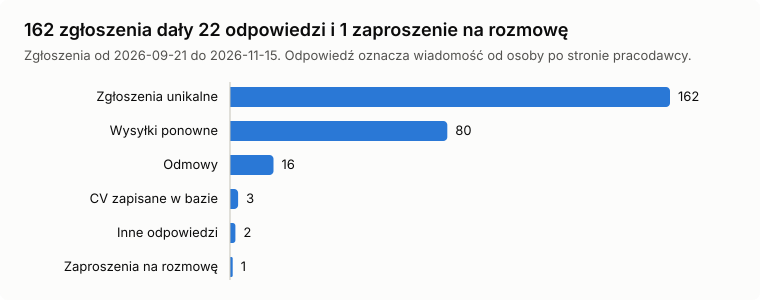
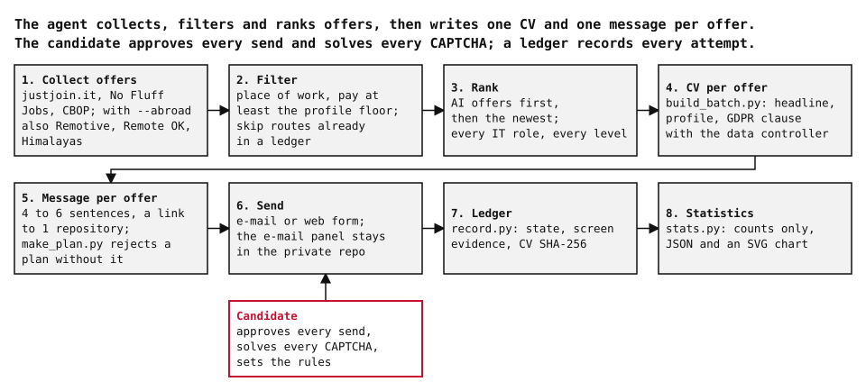

# job-search-agent

Python tools and a written method for a job search that a coding agent runs for one candidate: the agent collects offers, writes one CV and one message per offer, and records every send in a ledger.

[Wersja polska](README.pl.md)

## Results



`tools/stats.py` counted these numbers on 2026-11-15 at 18:56 CET from the private ledgers of one job search, 2026-09-21 to 2026-11-15. [docs/stats.json](docs/stats.json) holds every number in this section. The chart labels are in Polish.

| Measure | Count |
|---|---|
| Unique applications: first confirmed send to one employer and position | 162 |
| Resends of a CV to the same employer and position | 80 |
| Messages in an existing mail thread | 17 |
| Routes without a confirmed send | 14 |
| Employer responses | 22 |
| Refusals | 16 |
| Notices that the CV was filed | 3 |
| Other responses | 2 |
| Interview invitations | 1 |

| Month | Unique applications | Resends | Responses |
|---|---|---|---|
| 2026-09 | 2 | 0 | 0 |
| 2026-10 | 83 | 0 | 9 |
| 2026-11 | 77 | 80 | 13 |

| Sending channel | Unique applications |
|---|---|
| e-mail over SMTP | 102 |
| pracuj.pl form | 31 |
| other form: an ATS or the employer's site | 18 |
| justjoin.it form | 9 |
| No Fluff Jobs form | 2 |

| Offer type | Unique applications |
|---|---|
| job ad on a portal or on the employer's site | 96 |
| unsolicited application, no job ad | 58 |
| offer from CBOP, the Polish public employment service | 8 |

The same ledgers give the days: the agent sent 80 applications on 2026-10-02, re-sent 63 CVs on 2026-11-03 with the GDPR consent clause that the October CVs lacked, re-sent 17 CVs on 2026-11-11 with a new profile, and sent the first CBOP application on 2026-11-09.

Conclusion: 162 unique applications led to 1 interview invitation, and 16 of the 22 responses were refusals.

## Quick start

Requirements: Python 3.13 or newer with the standard library. `tools/build_cv.py`, and `tools/build_batch.py` outside its self-check, also need `python-docx`, `pymupdf` and LibreOffice (`soffice`).

```sh
git clone https://github.com/maciejszulia/job-search-agent.git
cd job-search-agent
python3 -I tools/fetch_it_offers.py --demo
python3 -I tools/cbop_scan.py --demo
python3 -I tools/make_plan.py
python3 -I tools/record.py --demo
python3 -I tools/stats.py --demo
python3 -I tools/correct_cv.py --selftest
python3 -I tools/build_batch.py --demo
python3 -I tools/build_cv.py --demo
```

Every self-check runs offline on synthetic data and prints `ok`, `selftest ok` or `demo OK`. The CI workflow [.github/workflows/ci.yml](.github/workflows/ci.yml) runs the same checks on Python 3.13.

### Run on your own data

1. Create `private/` in the repository directory. `.gitignore` excludes `private/`.
2. Copy [examples/profile.example.json](examples/profile.example.json) to `private/profile.json` and enter your own data.
3. Save a baseline CV in Markdown in `private/baselines/`, modelled on the demo in `tools/build_batch.py`.
4. Run the commands below in order. The agent writes the specs, the offer details and one message per offer between steps A and B.

```sh
# A: offers (--abroad adds remote offers of foreign companies that are open to candidates in Poland)
python3 -I tools/fetch_it_offers.py --profile private/profile.json --seen private/portal-submissions.jsonl --abroad > private/shortlist.jsonl
python3 -I tools/cbop_scan.py --profile private/profile.json --out private/cbop-candidates.json
# B: plan, one CV variant and one message per offer
python3 -I tools/make_plan.py private/profile.json private/specs.json private/details.json private/messages.json > private/plan.json
# C: CVs
python3 -I tools/build_batch.py --profile private/profile.json --plan private/plan.json --baselines private/baselines --out private/cv
# D: one ledger entry after every send
python3 -I tools/record.py --plan private/plan.json --cv-dir private/cv --ledger private/portal-submissions.jsonl \
  --profile private/profile.json it-ai-engineer-acme "Done! Your application has been sent"
# E: statistics (--submissions and --queue read the ledger and the queue of an e-mail panel, when you have one)
python3 -I tools/stats.py --portal private/portal-submissions.jsonl --outcomes private/outcomes.jsonl --out private/stats
```

The outcomes file holds one employer response per line: date, event, private reference and source. The event is one of `refusal`, `cv_filed`, `other_reply`, `interview_invitation`. [examples/outcomes.example.jsonl](examples/outcomes.example.jsonl) shows the format.

## How it works



| Step | Tool | What it does |
|---|---|---|
| 1. Collect | `tools/fetch_it_offers.py` | Reads the justjoin.it and No Fluff Jobs APIs. With `--abroad` it also reads Remotive, Remote OK and Himalayas and keeps an offer only when the offer is open to candidates in Poland. |
| 1. Collect | `tools/cbop_scan.py` | Reads CBOP and keeps office, computer and managerial roles within `max_km` of the home point or remote, with an e-mail address for applications and open to candidates who are not registered at an employment office. |
| 2. Filter | `tools/fetch_it_offers.py` | Keeps remote work, hybrid work in a Polish city and any work in the home city. Drops pay below the profile floor and offers that a ledger already holds. Does not filter by level or by title. |
| 3. Rank | `tools/fetch_it_offers.py` | Puts AI and automation offers first, then the newest offers. |
| 4. CV | `tools/correct_cv.py`, `tools/build_batch.py`, `tools/build_cv.py` | Sets the headline, the profile and the GDPR consent clause for the offer, then builds DOCX and PDF. The PDF check fails when text or a font is missing, or when the text leaves the page limit or the margins. |
| 5. Message | `tools/make_plan.py` | Rejects a plan row without a message, without the profile links or without a link to one repository. |
| 6. Send | private e-mail panel or the candidate | The panel holds mail credentials, so it stays in the private repository. |
| 7. Ledger | `tools/record.py` | Appends the date, the state, the evidence seen on the screen and the SHA-256 of the uploaded CV. |
| 8. Statistics | `tools/stats.py` | Writes counts only, with no employer or person names. |

The tools use only the Python standard library, except the DOCX and PDF step.

## Rules the candidate set for the agent

- Every IT role at every level, senior, lead and expert included. A senior role gets the same CV; the agent adds no experience (2026-11-15).
- AI and automation offers go first. Office offers from CBOP go after the IT batch (2026-11-15).
- At most 15 applications per day, 5 to 15 minutes between sends (2026-11-15).
- From 2026-11-16 also managerial roles. Among them, IT and AI roles go first (team lead, engineering manager, IT project manager, product owner, head of AI); other managerial roles go after the IT batch, like office offers. The agent adds no people-management experience (2026-11-15).
- Work abroad: remote work for foreign companies first, then offers with relocation. Such an application gets a CV and a message in English or in the language of the offer (2026-11-15).
- One message per offer, 4 to 6 sentences: why this role, one fact from the candidate's fact file that matches the offer, availability, the profile links and one repository closest to the offer. No shared paragraph and no list of models (2026-11-15).
- Every salary figure in an application carries the word "negotiable". Before the agent proposes a figure, it researches published ranges for the same role (2026-11-14, 2026-11-15).
- No message that reads like a mass mailing (2026-11-09).
- Every CV ends with a GDPR consent clause that names the data controller and its seat. When the offer gives its own clause, the agent uses that clause word for word.
- A CAPTCHA stays with the candidate: the agent records the state `filled-awaiting-owner` and leaves the click to the candidate.
- The agent creates no accounts on recruitment portals.
- The agent takes facts about the candidate only from the candidate's fact file.
- The ledger keeps every attempt, failed attempts included, and the agent checks the ledger before every send.
- Personal data stays out of the Git history of this repository: the profile, the ledgers, the CVs and the correspondence live in `private/`, which `.gitignore` excludes.

## Limits

- The repository sends no messages. The private panel or the candidate sends them.
- The statistics describe one job search. They do not describe the job market.
- The candidate records employer responses in the outcomes file by hand. Automatic refusals from portals are not counted.
- `fetch_it_offers.py` converts gross to net pay with a flat factor of 0.72, so the pay filter is an approximation.
- The tools follow the portal APIs as of 2026-11-15. A change of a portal API needs a change of the code.
- `--abroad` reads remote offers only. Relocation offers have no source with an open API in this repository.
- 5 tools stayed in the private repository because their code holds private data: the e-mail sending panel, mail sorting into labels, the pracuj.pl collector and filter, the CBOP application builder, and the offer freshness check with the data-controller lookup in the Polish court register (KRS). Each one needs its data moved to the profile and a `demo()` self-check before it can move here.

## License

MIT License, see [LICENSE](LICENSE).

## Author

Maciej Szulia: [github.com/maciejszulia](https://github.com/maciejszulia), [gitlab.com/maciejszulia](https://gitlab.com/maciejszulia).
