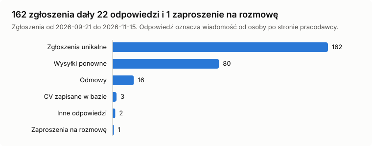
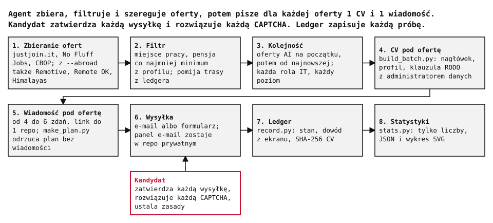

# job-search-agent

Repo `job-search-agent` zawiera narzędzia w Pythonie oraz opis metody, według której agent prowadzi poszukiwanie pracy dla 1 kandydata. Agent zbiera oferty, pisze dla każdej oferty 1 CV oraz 1 wiadomość i zapisuje każdą wysyłkę w ledgerze.

[English version](README.md)

Legenda: MUSI oznacza wymóg. NIE WOLNO oznacza zakaz. MOŻE oznacza zezwolenie. Słowo „lub” oznacza co najmniej 1 człon. Słowo „albo” oznacza dokładnie 1 człon.

## Słownik

| Termin | Definicja | Słowa zakazane dla tego pojęcia |
|---|---|---|
| kandydat | Osoba, która szuka pracy i ustala zasady wysyłki. | użytkownik, klient |
| agent | Program z modelem językowym, który wykonuje kroki metody. | asystent, bot |
| profil | Plik JSON z danymi kandydata dla narzędzi, na wzór pliku `examples/profile.example.json`. | konfiguracja, ustawienia |
| plik faktów | Plik, który zawiera fakty o kandydacie zatwierdzone przez kandydata. | biografia |
| ledger | Plik JSON albo plik JSONL, który zapisuje każdą próbę wysyłki z datą oraz stanem. | rejestr, dziennik |
| trasa | Para: 1 pracodawca oraz 1 stanowisko. Ledger zapisuje trasę jako 1 klucz. | aplikacja |
| zgłoszenie unikalne | Pierwsza potwierdzona wysyłka CV na 1 trasę. | aplikacja |
| wysyłka ponowna | Każda późniejsza potwierdzona wysyłka CV na trasę, która ma zgłoszenie unikalne. | resend |
| odpowiedź | 1 wiadomość od osoby po stronie pracodawcy, zapisana w pliku zdarzeń. | odzew, reakcja |
| plik zdarzeń | Plik JSONL, który zapisuje każdą odpowiedź w osobnym wierszu. | outcomes |
| sprawdzian | Funkcja w narzędziu, która sprawdza narzędzie na danych syntetycznych bez sieci. | test ręczny |

Skróty: AI (artificial intelligence) oznacza sztuczną inteligencję. API (application programming interface) oznacza interfejs programistyczny portalu. ATS (Applicant Tracking System) oznacza system rekrutacyjny pracodawcy. CAPTCHA oznacza test, który odróżnia człowieka od programu. CBOP (Centralna Baza Ofert Pracy) oznacza portal ofert urzędów pracy. CV (curriculum vitae) oznacza życiorys zawodowy. IT (information technology) oznacza informatykę. KRS (Krajowy Rejestr Sądowy) oznacza rejestr spółek. RODO oznacza rozporządzenie Unii Europejskiej 2016/679 o ochronie danych osobowych. SMTP (Simple Mail Transfer Protocol) oznacza protokół wysyłki poczty. Repo oznacza repozytorium Git. JSON, JSONL, SVG, DOCX oraz PDF oznaczają formaty plików.

## Wyniki



Skrypt `tools/stats.py` policzył liczby 2026-11-15 o godz. 18:56 czasu środkowoeuropejskiego. Skrypt czytał ledgery prywatne 1 poszukiwania pracy z okresu od 2026-09-21 do 2026-11-15 włącznie. Plik [docs/stats.json](docs/stats.json) zawiera każdą liczbę z tej sekcji.

| Miara zgłoszeń | Liczba |
|---|---|
| Zgłoszenia unikalne | 162 |
| Wysyłki ponowne | 80 |
| Wiadomości w istniejącym wątku poczty | 17 |
| Trasy bez potwierdzonej wysyłki | 14 |

| Odpowiedź pracodawcy | Liczba |
|---|---|
| Odmowa | 16 |
| Informacja o zapisaniu CV w bazie | 3 |
| Inna odpowiedź | 2 |
| Zaproszenie na rozmowę | 1 |
| Razem | 22 |

| Miesiąc | Zgłoszenia unikalne | Wysyłki ponowne | Odpowiedzi |
|---|---|---|---|
| 2026-09 | 2 | 0 | 0 |
| 2026-10 | 83 | 0 | 9 |
| 2026-11 | 77 | 80 | 13 |

| Kanał wysyłki | Zgłoszenia unikalne |
|---|---|
| e-mail przez SMTP | 102 |
| formularz pracuj.pl | 31 |
| inny formularz: ATS albo strona pracodawcy | 18 |
| formularz justjoin.it | 9 |
| formularz No Fluff Jobs | 2 |

| Typ oferty | Zgłoszenia unikalne |
|---|---|
| ogłoszenie na portalu albo na stronie pracodawcy | 96 |
| zgłoszenie z własnej inicjatywy, bez ogłoszenia | 58 |
| oferta z CBOP | 8 |

Te same ledgery podają daty wysyłek. Agent wysłał 80 zgłoszeń unikalnych 2026-10-02. Agent wykonał 63 wysyłki ponowne 2026-11-03. CV z tych wysyłek miały klauzulę RODO. CV z października nie miały klauzuli RODO. Agent wykonał 17 wysyłek ponownych 2026-11-11 z CV z nowym profilem. Agent wysłał pierwsze zgłoszenie unikalne na ofertę z CBOP 2026-11-09.

Wniosek: 162 zgłoszenia unikalne dały 1 zaproszenie na rozmowę. Odmowy stanowią 16 z 22 odpowiedzi.

## Szybki start

Wymagania: Python co najmniej w wersji 3.13 oraz biblioteka standardowa. Skrypt `tools/build_cv.py` wymaga dodatkowo pakietów `python-docx` i `pymupdf` oraz programu LibreOffice. Skrypt `tools/build_batch.py` wymaga tych samych pakietów przy pracy na własnych danych. Sprawdzian skryptu `tools/build_batch.py` działa bez tych pakietów.

Wykonaj każde polecenie z bloku kodu w tej kolejności:

```sh
git clone https://github.com/maciejszulia/job-search-agent.git
cd job-search-agent
python3 -I tools/fetch_it_offers.py --demo
python3 -I tools/cbop_scan.py --demo
python3 -I tools/make_plan.py
python3 -I tools/record.py --demo
python3 -I tools/stats.py --demo
python3 -I tools/correct_cv.py --selftest
python3 -I tools/build_batch.py --demo
python3 -I tools/build_cv.py --demo
```

Wynik: każdy sprawdzian wypisuje `ok`, `selftest ok` albo `demo OK`. Każdy sprawdzian działa bez sieci na danych syntetycznych. Workflow w pliku [.github/workflows/ci.yml](.github/workflows/ci.yml) uruchamia te same sprawdziany w Pythonie w wersji 3.13.

### Praca na własnych danych

Wykonaj każdy krok w tej kolejności:

1. Utwórz katalog `private/` w katalogu repo. Plik `.gitignore` pomija katalog `private/`.
2. Skopiuj plik [examples/profile.example.json](examples/profile.example.json) jako plik `private/profile.json`.
3. Wpisz własne dane do pliku `private/profile.json`.
4. Zapisz wersję bazową CV w formacie Markdown w katalogu `private/baselines/`. Wzorem jest demo w pliku `tools/build_batch.py`.
5. Pobierz oferty poleceniami z bloku A.
6. Poproś agenta o pliki `private/specs.json`, `private/details.json` oraz `private/messages.json`. Plik `private/messages.json` zawiera 1 wiadomość dla każdej oferty.
7. Zbuduj plan zgłoszeń poleceniem z bloku B.
8. Zbuduj CV poleceniem z bloku C.
9. Po każdej wysyłce zapisz wpis w ledgerze poleceniem z bloku D.
10. Policz statystyki poleceniem z bloku E.

```sh
# A: offers (--abroad adds remote offers of foreign companies that are open to candidates in Poland)
python3 -I tools/fetch_it_offers.py --profile private/profile.json --seen private/portal-submissions.jsonl --abroad > private/shortlist.jsonl
python3 -I tools/cbop_scan.py --profile private/profile.json --out private/cbop-candidates.json
# B: plan, one CV variant and one message per offer
python3 -I tools/make_plan.py private/profile.json private/specs.json private/details.json private/messages.json > private/plan.json
# C: CVs
python3 -I tools/build_batch.py --profile private/profile.json --plan private/plan.json --baselines private/baselines --out private/cv
# D: one ledger entry after every send
python3 -I tools/record.py --plan private/plan.json --cv-dir private/cv --ledger private/portal-submissions.jsonl \
  --profile private/profile.json it-ai-engineer-acme "Done! Your application has been sent"
# E: statistics (--submissions and --queue read the ledger and the queue of an e-mail panel, when you have one)
python3 -I tools/stats.py --portal private/portal-submissions.jsonl --outcomes private/outcomes.jsonl --out private/stats
```

Plik zdarzeń zawiera 1 odpowiedź w 1 wierszu. Wiersz zawiera datę, typ zdarzenia, odnośnik prywatny oraz źródło. Typ zdarzenia przyjmuje dokładnie 1 z 4 wartości: `refusal`, `cv_filed`, `other_reply`, `interview_invitation`. Plik [examples/outcomes.example.jsonl](examples/outcomes.example.jsonl) pokazuje format.

## Sposób działania



Agent wykonuje każdy krok w tej kolejności:

1. Zbieranie: skrypt `tools/fetch_it_offers.py` czyta API portali justjoin.it oraz No Fluff Jobs. Z opcją `--abroad` skrypt czyta także API portali Remotive, Remote OK oraz Himalayas. Tylko jeżeli oferta z zagranicy przyjmuje kandydatów z Polski, skrypt zostawia ofertę z zagranicy. Skrypt `tools/cbop_scan.py` czyta oferty z CBOP.
2. Filtr: skrypt `tools/fetch_it_offers.py` zostawia pracę zdalną, pracę hybrydową w mieście w Polsce oraz każdą pracę w mieście kandydata. Skrypt odrzuca ofertę z pensją mniejszą niż minimum z profilu. Skrypt odrzuca ofertę, którą ledger już zawiera. Skrypt nie filtruje poziomu ani nazwy stanowiska.
3. Filtr CBOP: skrypt `tools/cbop_scan.py` zostawia stanowiska biurowe, komputerowe oraz menedżerskie. Oferta MUSI podawać adres e-mail do zgłoszeń. Oferta MUSI przyjmować kandydatów bez rejestracji w urzędzie pracy. Oferta MUSI spełnić co najmniej 1 z 2 warunków: miejsce pracy leży w promieniu `max_km` od punktu `home` z profilu; oferta dotyczy pracy zdalnej.
4. Kolejność: skrypt `tools/fetch_it_offers.py` stawia oferty AI oraz oferty automatyzacji przed pozostałymi ofertami. W każdej z 2 grup skrypt stawia najnowszą ofertę na początku.
5. CV pod ofertę: skrypty `tools/correct_cv.py`, `tools/build_batch.py` oraz `tools/build_cv.py` budują CV z wersji bazowej. CV dostaje nagłówek, profil oraz klauzulę RODO z nazwą administratora danych. Skrypt `tools/build_cv.py` buduje plik DOCX oraz plik PDF. Plik PDF MUSI zawierać cały tekst z pliku DOCX. Plik PDF MUSI osadzać każdą czcionkę, której używa. Tekst MUSI mieścić się w limicie stron oraz w marginesach.
6. Wiadomość pod ofertę: agent pisze 1 wiadomość dla 1 oferty. Skrypt `tools/make_plan.py` odrzuca wiersz planu bez wiadomości, bez linków z profilu albo bez linku, który wskazuje 1 repo.
7. Wysyłka: agent wysyła e-mail albo wypełnia formularz w przeglądarce kandydata. Panel wysyłki e-mail leży w repo prywatnym, bo kod panelu zawiera dane logowania do poczty.
8. Ledger: skrypt `tools/record.py` dopisuje wpis z datą, stanem, dowodem z ekranu oraz skrótem SHA-256 pliku CV.
9. Statystyki: skrypt `tools/stats.py` liczy zgłoszenia z ledgerów oraz odpowiedzi z pliku zdarzeń. Wynik zawiera tylko liczby. Skrypt rysuje wykres SVG.

## Zasady kandydata dla agenta

Każda zasada podaje datę reguły w nawiasie.

- Agent wysyła zgłoszenia na każde stanowisko IT, na każdym poziomie, także senior, lead oraz expert (2026-11-15).
- Stanowisko senior dostaje to samo CV. Agentowi NIE WOLNO dopisać doświadczenia (2026-11-15).
- Oferty AI oraz oferty automatyzacji idą pierwsze. Oferty biurowe z CBOP idą po partii IT (2026-11-15).
- Partia ma co najwyżej 15 zgłoszeń na dzień. Odstęp między wysyłkami wynosi od 5 min do 15 min włącznie (2026-11-15).
- Od 2026-11-16 włącznie agent wysyła zgłoszenia także na stanowiska menedżerskie (2026-11-15).
- Wśród stanowisk menedżerskich najpierw idą stanowiska w IT oraz w AI: team lead, engineering manager, IT project manager, product owner, head of AI (2026-11-15).
- Inne stanowiska menedżerskie idą po partii IT, tak jak oferty biurowe (2026-11-15).
- Agentowi NIE WOLNO dopisać doświadczenia w zarządzaniu ludźmi (2026-11-15).
- Agent szuka także pracy za granicą. Najpierw idzie praca zdalna dla pracodawców z zagranicy, potem oferty z relokacją (2026-11-15).
- Zgłoszenie do pracodawcy z zagranicy dostaje CV po angielsku albo w języku oferty. Wiadomość ma język CV (2026-11-15).
- Agent pisze 1 wiadomość dla 1 oferty. Wiadomość MUSI mieć od 4 do 6 zdań włącznie (2026-11-15).
- Wiadomość podaje powód wyboru stanowiska oraz 1 fakt z pliku faktów. Ten fakt pasuje do wymagań oferty (2026-11-15).
- Wiadomość podaje dostępność kandydata, linki z profilu oraz link, który wskazuje 1 repo wybrane przez agenta jako najbliższe ofercie (2026-11-15).
- Wiadomość nie zawiera akapitu wspólnego z inną wiadomością. Wiadomość nie zawiera listy modeli (2026-11-15).
- Każda kwota wynagrodzenia w zgłoszeniu MUSI mieć dopisek „do negocjacji” (2026-11-15).
- Zanim agent zaproponuje kwotę, agent sprawdza widełki, które pracodawcy publikują dla tego samego stanowiska (2026-11-14).
- Agentowi NIE WOLNO wysłać wiadomości, która wygląda jak masowa wysyłka (2026-11-09).
- Agent MUSI zakończyć każde CV klauzulą RODO z nazwą oraz siedzibą administratora danych.
- Jeżeli oferta podaje własną klauzulę, to agent wstawia klauzulę z oferty bez zmian.
- CAPTCHA zostaje przy kandydacie. Gdy formularz pokaże CAPTCHA, agent zapisuje stan `filled-awaiting-owner` i zostawia kliknięcie kandydatowi.
- Agentowi NIE WOLNO zakładać kont na portalach rekrutacyjnych. Trasa, która wymaga konta, zostaje przy kandydacie.
- Agent bierze fakty o kandydacie tylko z pliku faktów.
- Ledger przechowuje każdą próbę, także próbę nieudaną. Agent sprawdza ledger przed każdą wysyłką.
- Dane osobowe zostają poza historią Git tego repo. Profil, ledgery, CV oraz korespondencja leżą w katalogu `private/`, który plik `.gitignore` pomija.

## Granice

- Repo nie wysyła wiadomości. Wysyłkę wykonuje panel wysyłki e-mail z repo prywatnego albo kandydat.
- Statystyki opisują 1 poszukiwanie pracy. Statystyki nie opisują rynku pracy.
- Kandydat zapisuje odpowiedzi pracodawców w pliku zdarzeń ręcznie. Statystyki pomijają odmowy automatyczne z portali.
- Skrypt `tools/fetch_it_offers.py` mnoży pensję brutto przez 0,72 i traktuje wynik jako pensję netto. Filtr pensji daje przybliżenie.
- Narzędzia działają z API portali w stanie z 2026-11-15. Zmiana API portalu wymaga zmiany kodu.
- Opcja `--abroad` zbiera tylko oferty zdalne. Repo nie ma źródła ofert z relokacją z otwartym API.

Lista podaje 5 narzędzi, które zostały w repo prywatnym. Kod każdego z tych narzędzi zawiera dane prywatne.

- Panel wysyłki e-mail wysyła e-maile oraz zapisuje ledger i kopie wiadomości.
- Skrypt sortuje pocztę do etykiet.
- Skrypt pobiera oferty z portalu pracuj.pl oraz filtruje oferty z portalu pracuj.pl.
- Skrypt buduje wiersze zgłoszeń z ofert CBOP.
- Skrypt sprawdza aktualność ofert oraz szuka administratora danych w KRS.

Każde narzędzie z listy wymaga 2 zmian przed przeniesieniem do repo publicznego:

1. Dane prywatne z kodu narzędzia trafiają do profilu.
2. Narzędzie dostaje sprawdzian `demo()`.

## Licencja

Licencja MIT, plik [LICENSE](LICENSE).

## Autor

Maciej Szulia: [github.com/maciejszulia](https://github.com/maciejszulia), [gitlab.com/maciejszulia](https://gitlab.com/maciejszulia).
