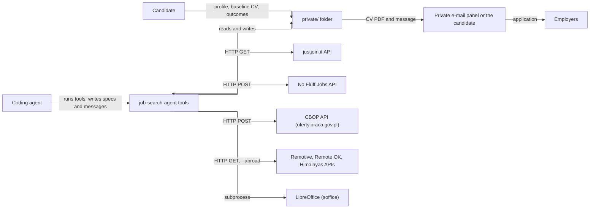
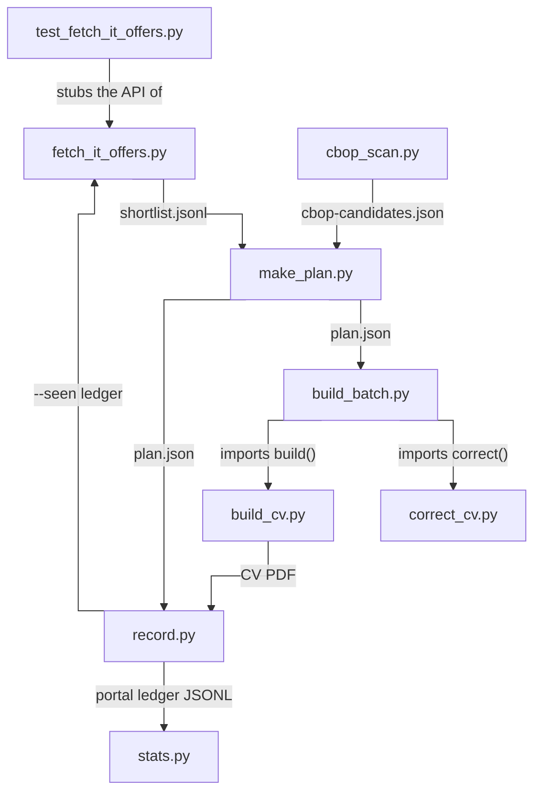
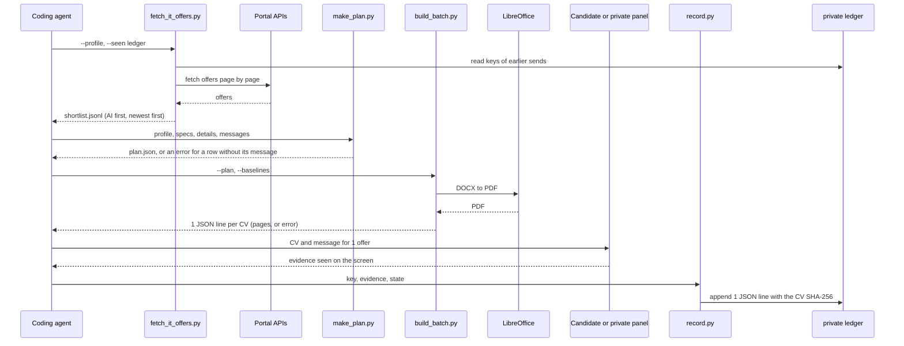

# job-search-agent: architecture

This document describes the architecture of `job-search-agent` in the arc42 layout. It covers the code on the
default branch. Every statement names the file that shows it.

## 1. Introduction and goals

`job-search-agent` holds Python tools and a written method for a job search that a coding agent runs for one
candidate: the agent collects offers, writes one CV and one message per offer, and records every send in a ledger
([README.md](../../README.md)).

| Goal | Where it shows |
| --- | --- |
| Collect and rank job offers from public portal APIs | [`tools/fetch_it_offers.py`](../../tools/fetch_it_offers.py), [`tools/cbop_scan.py`](../../tools/cbop_scan.py) |
| Build 1 tailored CV per offer as DOCX and PDF, and fail on a broken PDF | [`tools/correct_cv.py`](../../tools/correct_cv.py), [`tools/build_batch.py`](../../tools/build_batch.py), [`tools/build_cv.py`](../../tools/build_cv.py) |
| Refuse a plan row without its own message | [`tools/make_plan.py`](../../tools/make_plan.py) |
| Keep an append-only record of every send attempt | [`tools/record.py`](../../tools/record.py) |
| Publish counts without personal data | [`tools/stats.py`](../../tools/stats.py), [`docs/stats.json`](../../docs/stats.json) |

Stakeholders: the candidate, who owns the profile, the ledgers and the final click; the coding agent, which runs
the tools and writes specs and messages; readers of the published statistics.

## 2. Constraints

| Constraint | Evidence |
| --- | --- |
| Python 3.13 or newer; CI uses Python 3.13 | [README.md](../../README.md), [`.github/workflows/ci.yml`](../../.github/workflows/ci.yml) |
| Standard library only, except the DOCX and PDF step (`python-docx`, `pymupdf`, LibreOffice `soffice`) | imports in `tools/*.py`, docstring of [`tools/build_cv.py`](../../tools/build_cv.py) |
| Personal data stays in `private/`, which Git ignores | [`.gitignore`](../../.gitignore) |
| The repository sends no messages; a private panel or the candidate sends them | [README.md](../../README.md), section "Limits" |
| The tools follow the portal APIs as of 2026-11-15 | [README.md](../../README.md), section "Limits" |
| License: MIT | [LICENSE](../../LICENSE) |

## 3. Context and scope

In scope: offer collection, filtering and ranking, CV build and check, plan validation, ledger records, statistics.
Out of scope: sending e-mail and filling forms; 5 tools stayed in a private repository because their code holds
private data ([README.md](../../README.md), section "Limits").

## 4. Solution strategy

| Problem | Approach | Evidence |
| --- | --- | --- |
| Many portals with different payloads | 1 normaliser per portal maps each offer to 1 row format (`from_jj`, `from_nfj`, `remote_row`) | [`tools/fetch_it_offers.py`](../../tools/fetch_it_offers.py) |
| Duplicate applications | Drop an offer whose normalised URL or `company\|title` pair is already in a ledger | `ledger_keys()`, `shortlist()` in [`tools/fetch_it_offers.py`](../../tools/fetch_it_offers.py) |
| CV text per offer | Plain-text Markdown baseline, regex corrections, then DOCX, then PDF through LibreOffice | [`tools/correct_cv.py`](../../tools/correct_cv.py), [`tools/build_cv.py`](../../tools/build_cv.py) |
| A PDF that loses text or leaves the page | `verify()` asserts page count, missing text, margins, overlapping lines and embedded fonts | `verify()` in [`tools/build_cv.py`](../../tools/build_cv.py) |
| Trust in the record | Append-only JSONL ledger with the SHA-256 of the uploaded CV | [ADR 0003](adr/0003-append-only-ledger-with-cv-hash.md) |
| Regression safety without network | Every tool has an offline `--demo` or `--selftest`; CI runs them | [ADR 0004](adr/0004-offline-self-checks-in-ci.md) |

## 5. Building block view

| Block | Responsibility |
| --- | --- |
| [`tools/fetch_it_offers.py`](../../tools/fetch_it_offers.py) | Reads justjoin.it and No Fluff Jobs; with `--abroad` also Remotive, Remote OK and Himalayas. Keeps remote work, hybrid work in a listed Polish city and any work in the home city; drops pay below the profile floor and offers already in a ledger; ranks AI offers first, then newest. Prints JSON Lines. |
| [`tools/cbop_scan.py`](../../tools/cbop_scan.py) | Reads CBOP in pages of 200. Keeps offers with an e-mail address, open to non-registered candidates, within `max_km` of the home point or remote, whose title matches the office pattern and not the exclusion pattern. |
| [`tools/make_plan.py`](../../tools/make_plan.py) | Joins specs, offer details and messages into plan rows. Raises an error when a spec matches other than 1 offer, when there is no data controller and no verbatim consent, or when the message lacks the profile links or a repository link. |
| [`tools/correct_cv.py`](../../tools/correct_cv.py) | `correct()`: sets the headline (at most 70 characters), the profile (at most 60 words) and the consent clause; removes level qualifiers and "junior" labels. |
| [`tools/build_batch.py`](../../tools/build_batch.py) | 1 CV per plan row: fixed-line replacements from the profile, then `correct()`, then `build_cv.build()`. Reports every row and stops on none. |
| [`tools/build_cv.py`](../../tools/build_cv.py) | Markdown or JSON spec to DOCX (`python-docx`), DOCX to PDF (`soffice --headless`), then `verify()` with `pymupdf`. |
| [`tools/record.py`](../../tools/record.py) | Appends 1 ledger line per attempt: offer, key, state, evidence, CV file name, CV SHA-256, date and time. |
| [`tools/stats.py`](../../tools/stats.py) | Counts unique applications, resends, thread messages, incomplete routes and responses; writes `stats.json` and `stats.svg`. |
| [`tools/test_fetch_it_offers.py`](../../tools/test_fetch_it_offers.py) | Regression test: a stubbed justjoin.it API with 942 offers; `jj_offers` must read every page unless capped and report a cap on stderr. |

## 6. Runtime view

Main flow: 1 day of applications (steps A to D of [README.md](../../README.md), section "Run on your own data").

Step E: `tools/stats.py` reads the ledgers and the outcomes file and writes counts only
(docstring of [`tools/stats.py`](../../tools/stats.py)).

A CAPTCHA leaves the click to the candidate; the agent records the state `filled-awaiting-owner`
(docstring of [`tools/record.py`](../../tools/record.py)).

## 7. Deployment view

The tools run as command-line scripts from the repository folder on the candidate's machine. There is no server
and no service. Input and output files live in `private/` ([README.md](../../README.md), section "Run on your own
data"). CI runs on GitHub Actions, `ubuntu-latest`, Python 3.13, and installs `libreoffice-writer`,
`fonts-liberation`, `python-docx` and `pymupdf` for the CV build check
([`.github/workflows/ci.yml`](../../.github/workflows/ci.yml)).

## 8. Crosscutting concepts

- **Data separation.** The profile, ledgers, outcomes, CVs and correspondence live in `private/`; examples use
  synthetic data ([`.gitignore`](../../.gitignore), [`examples/`](../../examples/profile.example.json)).
- **File formats.** JSON for the profile, specs and plan; JSON Lines for the shortlist, ledgers and outcomes.
  Outcome events are `refusal`, `cv_filed`, `other_reply`, `interview_invitation`; `stats.py` rejects other events.
- **Self-checks.** Every tool has an offline check: `--demo`, `--selftest`, or a run without arguments for
  `make_plan.py`.
- **Polite fetching.** `time.sleep()` between portal pages; CBOP makes up to 4 attempts for a page with an empty payload.
- **Explicit shortcuts.** `ponytail:` comments name known approximations, for example the flat gross-to-net factor
  0.72 and the hand list of Polish cities ([`tools/fetch_it_offers.py`](../../tools/fetch_it_offers.py)).
- **Time zone.** `stats.py` converts timestamps to `Europe/Warsaw` dates.

## 9. Architecture decisions

- [ADR 0001: Standard library only, except the DOCX and PDF step](adr/0001-standard-library-except-documents.md)
- [ADR 0002: Personal data stays in an ignored `private/` folder](adr/0002-private-data-outside-git.md)
- [ADR 0003: An append-only JSONL ledger with the SHA-256 of the uploaded CV](adr/0003-append-only-ledger-with-cv-hash.md)
- [ADR 0004: Offline self-checks in every tool, run by CI](adr/0004-offline-self-checks-in-ci.md)

## 10. Quality requirements

| Quality | Scenario | Check |
| --- | --- | --- |
| Correctness | 7 synthetic offers: office outside the home city, low pay, a ledger entry and a duplicate pair are dropped; AI offer first | `demo()` in [`tools/fetch_it_offers.py`](../../tools/fetch_it_offers.py) |
| Completeness | 942 stubbed offers: no silent page cap | [`tools/test_fetch_it_offers.py`](../../tools/test_fetch_it_offers.py) |
| Correctness | A plan row without its message is rejected | `demo()` in [`tools/make_plan.py`](../../tools/make_plan.py) |
| Document quality | A CV PDF over the page limit, with missing text, outside the margins or with a missing font fails | `verify()` in [`tools/build_cv.py`](../../tools/build_cv.py) |
| Traceability | A ledger line holds the SHA-256 of the uploaded CV | `demo()` in [`tools/record.py`](../../tools/record.py) |
| Privacy | Statistics hold counts only | docstring of [`tools/stats.py`](../../tools/stats.py) |

## 11. Risks and technical debt

| Risk or debt | Evidence |
| --- | --- |
| A change of a portal API breaks a collector | [README.md](../../README.md), section "Limits" |
| The pay filter uses a flat gross-to-net factor of 0.72 | `GROSS_TO_NET` in [`tools/fetch_it_offers.py`](../../tools/fetch_it_offers.py) |
| Hybrid offers from a city outside `PL_CITIES` are missed | `PL_CITIES` in [`tools/fetch_it_offers.py`](../../tools/fetch_it_offers.py) |
| A bad record makes CBOP skip its whole page | `ponytail:` comment in [`tools/cbop_scan.py`](../../tools/cbop_scan.py) |
| Relocation offers have no source with an open API | [README.md](../../README.md), section "Limits" |
| `tools/test_fetch_it_offers.py` is not in the CI workflow | [`.github/workflows/ci.yml`](../../.github/workflows/ci.yml) |
| 5 tools stay in a private repository until their data moves to the profile | [README.md](../../README.md), section "Limits" |
| Employer responses are entered by hand; automatic portal refusals are not counted | [README.md](../../README.md), section "Limits" |

### Open questions

- `make_plan.py` writes the channel `justjoin.it form (no account)` into every plan row, also for offers from other
  sources. The repository does not say whether this is intended.

## 12. Glossary

| Term | Meaning |
| --- | --- |
| Profile | `private/profile.json`: home point, pay floor, links, headline and profile text per language |
| Spec | 1 row per offer: key prefix, workplace, language, CV id, data controller, verbatim consent |
| Plan | `plan.json`: 1 row per offer with the CV fields and the message |
| Ledger | JSON Lines file with 1 line per send attempt |
| Route | 1 employer and 1 position (1 ledger key) |
| Unique application | The first confirmed send to a route |
| Resend | Every later confirmed send to a route |
| CBOP | Centralna Baza Ofert Pracy, the Polish public employment service offer database |
| Data controller | The company named in the GDPR consent clause of a CV |
